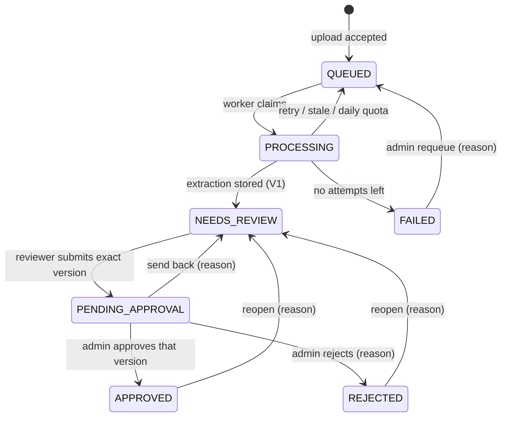

# Invoice Process — backend reverse-engineering runbook

A teaching guide for the developer who maintains this backend: how it works, where each thing lives, how to trace
one request, how to debug without guessing, and how to demo it to a senior.

> **2026-10-27 — backend became API-only.** The browser pages (`static/*.html`, `static/js/*`, `static/css/*`), the
> vanilla-JS E2E harness and the UI-only tests were archived outside the repository; sections below that describe pages,
> `login.html`, `session.js` or `cloud-pickers.js` describe that retired UI and are kept for history only. The login cookie
> is now `INVOICE_PROCESS_AUTH` (JWT issuer `actify-invoice-process`, audience `actify-invoice-process-web`); `GET /`
> answers 401/403; `GET /api/health` is the public health check. Current API: [REACT_BACKEND_HANDOFF.md](REACT_BACKEND_HANDOFF.md);
> deployment: [RENDER_DEPLOYMENT.md](RENDER_DEPLOYMENT.md). The storage folder `actify-task8-invoice-documents` keeps
> its old name on purpose (existing PDFs live there).

Written 2026-10-23 from the source code, updated 2026-10-24 after the first full workflow runs on the development
database. Companion documents (not repeated here):

- `docs/API_CONTRACT.md` — every route, request/response JSON, status codes (for the React developer).
- `docs/WORKFLOW_AND_OPERATIONS.md` — launch variables, approval gates, metric definitions, local-demo setup.
- `docs/sql/inspection-queries.sql` — the read-only SQL of section 21 in one runnable file.
- `docs/PROVIDER_SETUP_GOOGLE_DRIVE_ONEDRIVE.md` — Google Drive / OneDrive owner setup.

Evidence labels used below: **[SOURCE]** read in the code · **[TEST]** proven by a named test · **[LIVE]** observed on
the development database · **[NOT LIVE]** only mock-tested · **[NOT BUILT]** does not exist.

> Hinglish tip: Har section ke end mein ek "Senior ko kaise samjhaun" line hai — demo ke time wahi bolna.

---

## 0. Read this first — the application in 5 minutes

**What it does:** vendors upload invoice PDFs; Gemini reads each PDF into structured data; a human reviewer checks and
corrects that data next to the original PDF; an admin approves the exact corrected version. Nothing the AI produces is
ever final without a human.

**Who does what**

| Role | Page | Can do |
|---|---|---|
| VENDOR | `vendor.html` | start a batch, upload PDFs (local file; Google Drive / OneDrive once configured), finish the batch, see own invoices and their status |
| ADMIN | `admin.html` | create users and categories, map reviewers to categories, assign invoices to reviewers, approve / reject / send back / reopen / requeue, dashboards |
| REVIEWER | `reviewer.html` | see only assigned invoices, compare with the PDF, correct fields (each save = new version), submit for approval |

**The flow and what each step writes in the database** (all observed for invoice 52 on 2026-10-23 **[LIVE]**):

| # | Who / what | Status after | Rows written |
|---|---|---|---|
| 1 | Vendor starts a batch | – | `upload_batches` (OPEN) |
| 2 | Vendor uploads a PDF | QUEUED | file `<uuid>.pdf` on disk, `invoice_documents`, `invoices`, `extraction_jobs`, `invoice_workflow_events` |
| 3 | Vendor finishes the batch | QUEUED | `upload_batches.status = CLOSED`, `closed_at` |
| 4 | Worker claims the job (a few seconds later) | PROCESSING | `gemini_call_attempts` (IN_FLIGHT, before the call), event "Attempt 1" |
| 5 | Gemini answers, checks run | NEEDS_REVIEW | invoice fields + `invoice_items`, `invoice_versions` V1 (`LLM_EXTRACTION`), `invoice_review_reasons` (if any), attempt → SUCCESS with tokens, job `finished_at` |
| 6 | Admin assigns a reviewer (category must match) | unchanged | `invoices.assigned_reviewer_id`, event "Assigned to …" (from = to) |
| 7 | Reviewer corrects (optional) | NEEDS_REVIEW | `invoice_versions` V2, V3 … (`MANUAL_EDIT`, `changed_by = user:<id>`, field diff) |
| 8 | Reviewer submits | PENDING_APPROVAL | `invoices.submitted_version`, event "Submitted for approval" |
| 9 | Admin approves | APPROVED | event "Approved" with the version number |

Invoice 52 took 4.4 s in Gemini (1 409 tokens) and about 5 minutes end to end with real people clicking.
Assignment may happen before extraction too (invoice 51 was assigned while still QUEUED).

**How to start it:** Eclipse → Run → **"Invoice Process - Development"** (section 15.0). Open
`http://127.0.0.1:8088/login.html`. Stop with the red square in the Console view. That is the only configuration needed
for everyday work.

**How to check it worked:** section 21 (SQL) — "is the user created", "is the PDF stored", "did Gemini run", "who
approved".

*Senior ko kaise samjhaun:* "Vendor upload karta hai, worker Gemini se data nikalta hai, reviewer PDF ke saath compare
karke sudharta hai, admin exact version approve karta hai — aur har step ka record database mein hai."

---

## 1. Executive summary

Invoice Process is a Spring Boot **modular monolith**: one Java application, one PostgreSQL database, one folder of
private PDF files, and a small vanilla HTML/CSS/JS frontend served by the same application.

| Area | State |
|---|---|
| Login (JWT cookie), CSRF, roles VENDOR / REVIEWER / ADMIN, per-object 404 | implemented **[SOURCE][TEST]** |
| Vendor batch upload (≤100 PDFs, ≤10 MB each), SHA-256 duplicate check per vendor | implemented **[SOURCE][TEST]** |
| PostgreSQL job queue + Gemini worker with quota pacing and retries | implemented; **off** by default, **on** in the "Development" configuration — real extractions succeeded for invoices 51 and 52 on 2026-10-23 **[SOURCE][TEST][LIVE]** |
| Deterministic validator (review reasons) | implemented **[SOURCE][TEST]** |
| Immutable versions V1 (LLM) → V2+ (reviewer), submit / approve exact version | implemented **[SOURCE][TEST]** |
| Dashboards with explicit metric definitions | implemented **[SOURCE][TEST]** |
| Google Drive / OneDrive pickers | code + mock tests **[NOT LIVE]** — needs the owner's app registrations |
| Independent accuracy audit | **[NOT BUILT]** — shown as "not available" |
| Production readiness | **not production-ready** (no TLS, Spring Boot 2.7 past open-source support, local demo only) |

*Senior ko kaise samjhaun:* "Ek hi Spring Boot app hai; upload se approval tak har step database mein record hota hai,
aur LLM ka answer kabhi direct 'final' nahi maana jata — hamesha human review hota hai."

---

## 2. Architecture

```
Browser (static/*.html + js/*.js)        same origin http://127.0.0.1:8088
   |  JSON / multipart, cookie INVOICE_PROCESS_AUTH + header X-XSRF-TOKEN
   v
Spring Security filter chain (security/SecurityConfig)
   JwtCookieAuthenticationFilter -> role rules -> CSRF check
   v
Controllers (controller/*)  --- thin: parse request, call one service, return DTO
   v
Services (intake/, review/, service/, workflow/, dashboard/, queue/)  --- business rules + @Transactional
   |                         \
   v                          v
Repositories (repository/*, Spring Data JPA)      InvoiceDocumentStorage (storage/)
   v                                               v
PostgreSQL (12 tables)                             private folder  <id>.pdf  (SHA-256 checked)
   ^
   |  short transactions only
ExtractionWorker (@Scheduled, queue/)  --claim-->  GeminiQuotaGuard (quota/)  --HTTP (no DB lock held)-->  Gemini API
   |                                                                                     |
   +-- ExtractionOutcomeService: validator -> V1 version -> review reasons -> NEEDS_REVIEW <-+
   v
Reviewer corrects (V2, V3 ...) -> submit exact version -> Admin approves/rejects that exact version
```

**Transactions** (where they begin and end) **[SOURCE]**:

| Step | Transaction | Why |
|---|---|---|
| Upload a file | file stored **outside** a transaction, then one short `TransactionTemplate` (`BatchIntakeService#addFile`) | a crash never leaves a DB row without its file; an orphan file is deleted |
| Claim a job | `ExtractionJobService#claimNext` — one short transaction (`FOR UPDATE SKIP LOCKED` + advisory lock + attempt row) | two workers never take the same job |
| Gemini call | **no transaction, no lock** (`ExtractionWorker#processNextJob`) | a 2-minute network call must not hold a database lock |
| Store result | `ExtractionOutcomeService#storeForReview` — one transaction, invoice row locked | the result, V1, reasons and status move together |
| Correction | `InvoiceEditService#saveCorrection` — one transaction, `SELECT … FOR UPDATE` on the invoice | two saves cannot both become "V3" |

**Runtime** **[SOURCE]**: Spring Boot 2.7.18, Java source/target 8 (`pom.xml`), run on the installed JDK 17;
Maven Wrapper (`mvnw`, `mvnw.cmd`); PostgreSQL; Hibernate `ddl-auto=validate` (the app never changes the schema).

**Profiles** **[SOURCE][TEST]** (`src/main/resources`):

| Start | Profile used | Database | Notes |
|---|---|---|---|
| Plain "Run As › Java Application" / no profile | `localdemo` (it is `spring.profiles.default`) | `invoice_process_local_demo_db` only | no Gemini key, worker off; random login key if `INVOICE_JWT_SECRET` is unset — `DefaultProfileBootLoadingTest` |
| `-Dspring.profiles.active=localdemo` | `localdemo` | same | the "Invoice Process - localdemo" Eclipse configuration |
| `mvnw test -Ppgtest` | `pgtest` | `…_test_db` only | the only place `ddl-auto=update` is allowed |
| `-Dspring.profiles.active=development` | `development` | `Actify-Internship-Invoice-Process_db` (pinned in the launch file) | the everyday **"Invoice Process - Development"** configuration; passes the guard because the launch file sets `INVOICE_LIVE_START_APPROVED=true` and names that exact database |
| `-Dspring.profiles.active=live` (or any other) | that profile | whatever `INVOICE_DB_URL` says | refused unless `INVOICE_LIVE_START_APPROVED=true` **and** `INVOICE_APPROVED_DATABASE` names that exact database |

`config/SchemaSafetyGuard` runs **before any bean or connection exists** (a `BeanFactoryPostProcessor`) and refuses
unsafe starts. Why the *old* Eclipse configuration `InvoiceApplication` is refused: it has no profile (→ local-demo
rules) and it carries `GEMINI_API_KEY`, which the local demo forbids. That is intentional.

---

## 3. Repository map

`src/main/java/com/actify/invoice/…`

| Area | Files | Responsibility | Test | Common failure |
|---|---|---|---|---|
| Bootstrap | `InvoiceApplication`, `config/SchedulingConfig`, `config/TimeConfig` | start, scheduling, clock | – | – |
| Start guard | `config/SchemaSafetyGuard` | refuse unsafe DB/profile/schema settings before connecting | `SchemaSafetyGuardTest`, `DefaultProfileBootLoadingTest` | "SchemaSafetyGuard: REFUSING to start – …" (read the reason) |
| Security | `security/SecurityConfig`, `JwtCookieAuthenticationFilter`, `JwtTokenService`, `AuthCookies`, `LoginService`, `LoginAttemptLimiter`, `CurrentUserService`, `SecurityErrorWriter` | cookie JWT, CSRF, roles, token version, disabled users, login lock | `AuthSecurityWebTest`, `JwtTokenServiceTest`, `*RouteProtectionWebTest`, `AuthPgIntegrationTest` | 403 on POST = missing `X-XSRF-TOKEN`; 401 = cookie expired |
| Object access | `security/InvoiceAccessPolicy` | who may read/correct which invoice/PDF → 404/403 | `InvoiceRouteProtectionWebTest`, pgtests | "not found" for an invoice that exists = not yours (by design) |
| Users | `user/AppUser`, `AppUserService`, `AdminBootstrap`, `UserNames` | accounts, first admin, names (display name, else the e-mail before "@"; admin can rename) | `AppUserServiceTest`, `UserNamesTest` | – |
| Controllers | `controller/*` (13) | HTTP ↔ DTO | web tests | 415 wrong content type |
| DTOs | `dto/*` | JSON shapes | – | – |
| Batch intake | `intake/BatchIntakeService`, `intake/CategoryCodes` | batches, per-file checks, duplicate check, vendor lock, enqueue | `FolderPolicyTest`, `BatchSourcePolicyTest`, `BatchQueuePgIntegrationTest` | 422 `DUPLICATE_FILE` / `INVALID_FILE` |
| PDF | `service/PdfFiles`, `storage/InvoiceDocumentStorage`, `service/InvoiceDocumentService`, `controller/DocumentController` | validate, store privately, read back with SHA-256 | `InvoiceDocumentStorageTest` | 404 missing file, 500 integrity check |
| Queue | `queue/ExtractionWorker`, `ExtractionJobService`, `ExtractionOutcomeService` | claim, call, store, retry, recover | `BatchQueuePgIntegrationTest` | jobs stay QUEUED: worker off or limits unset |
| Quota | `quota/GeminiQuotaGuard`, `QuotaSettings`, `FailureClassifier` | RPM / TPM / RPD pacing, attempt rows, daily pause | `QuotaSettingsTest`, `FailureClassifierTest`, `QuotaPgIntegrationTest`, `DailyQuotaPgIntegrationTest` | "worker enabled but stays idle" log |
| LLM | `llm/GeminiInvoiceExtractor`, `prompts/*` | build request, parse JSON, read `usageMetadata` | `GeminiInvoiceExtractorTest` | 502 / retryable errors |
| Validation | `validation/InvoiceExtractionValidator`, `ReviewReasonCode`, `StorableValues` | deterministic checks → reason codes | `InvoiceExtractionValidatorTest`, `StorableValuesTest` | – |
| Versions | `versioning/*`, `service/InvoiceEditService`, `InvoiceVersionQueryService` | immutable snapshots + diffs, 409 on stale save | `InvoiceSnapshotMapperTest`, `InvoiceEditServiceTest`, `InvoiceVersioningPgIntegrationTest` | 409 "baseVersion" |
| Workflow | `workflow/WorkflowTransitions`, `WorkflowService`, `review/*` | allowed moves, events, assignment, submit, approval | `WorkflowTransitionsTest`, `ReviewApprovalPgIntegrationTest`, `ReviewReasonPrivacyTest` | 409 "Workflow conflict" |
| Dashboards | `dashboard/*` | metrics with definitions | `DashboardMetricsTest`, `DashboardPgIntegrationTest` | – |
| Cloud | `cloud/CloudSourceSettings`, `controller/CloudSourceController`, `static/js/cloud-pickers.js` | provider status + browser pickers | `CloudSourceSettingsTest`, e2e mock checks | "Not configured" |
| Errors | `exception/*` (17 classes), `GlobalExceptionHandler` | one JSON error shape | web tests | – |
| Frontend | `static/*.html`, `static/js/*.js`, `static/css/app.css` | pages per role | `src/test/frontend/invoice-review-ui.e2e.mjs` | console errors |

---

## 4. Security filters and roles

1. `JwtCookieAuthenticationFilter` reads cookie `INVOICE_PROCESS_AUTH`, verifies HS256 signature, issuer `actify-invoice-process`,
   audience `actify-invoice-process-web`, expiry (30 min). It then loads the user from `app_users` **on every request**: disabled user →
   unauthenticated; token version `tv` ≠ `app_users.token_version` → unauthenticated (that is how "log out everywhere"
   works). The role comes from the database, never from the token.
2. `SecurityConfig` route rules (default **deny**: `anyRequest().denyAll()`), e.g. `/api/admin/**` → ADMIN.
3. CSRF: `CookieCsrfTokenRepository.withHttpOnlyFalse()` — cookie `XSRF-TOKEN`, header `X-XSRF-TOKEN`; never disabled.
4. Object level: `InvoiceAccessPolicy` — someone else's invoice or PDF → **404** (indistinguishable from "missing").
5. Login: one generic 401 message; `LoginAttemptLimiter` locks after 5 failures for 15 minutes (per client address —
   on the loopback demo that means all logins).

*Senior ko kaise samjhaun:* "Token sirf identity batata hai; role aur enabled har request pe DB se check hota hai, isliye
role change ya disable turant lagu hota hai."

---

## 5. One request end-to-end (trace it in the debugger)

### 5.1 Vendor uploads one PDF — `POST /api/batches/{id}/files`

1. `BatchController#addFile` → `BatchIntakeService#addFile(batchId, file, relativePath, source)`.
2. Cheap checks (no lock): batch exists and is mine (else 404), batch OPEN and <100 files (else 409), declared source
   matches the batch (`SOURCE_MISMATCH`), not in a sub-folder (`NESTED_FOLDER`), `PdfFiles#validateAndRead`
   (`INVALID_FILE`), SHA-256 not already uploaded by me (`DUPLICATE_FILE`).
3. `InvoiceDocumentStorage#store` writes `<uuid>.pdf` into the private folder, reads it back, compares SHA-256.
4. One short transaction: **lock the vendor row** (`lockVendor`, `SELECT … FOR UPDATE` on `app_users`), lock the
   batch row, re-check limits and the duplicate, insert `invoice_documents`, `invoices` (QUEUED), `extraction_jobs`,
   one `invoice_workflow_events` row, increment the batch counter.
5. Response **202** `{accepted:true, invoiceId, status:"QUEUED"}`; any 422 rejection is also recorded on the batch.

### 5.2 Worker extracts — `ExtractionWorker#processNextJob`

1. `ExtractionJobService#claimNext`: quota check (`GeminiQuotaGuard#check`), oldest eligible job `FOR UPDATE SKIP
   LOCKED`, invoice → PROCESSING, attempt row IN_FLIGHT (counted **before** the call, so a crash still counts).
2. Read the PDF (SHA-256 verified), call Gemini (`GeminiInvoiceExtractor#extract`: prompt + whole PDF as base64
   `inlineData`, JSON schema response; connect 10 s, read 120 s) — **outside any transaction**.
3. Success → `ExtractionOutcomeService#storeForReview`: keep only values that fit the columns, raw answer, token usage,
   **V1** snapshot, review reasons (validator + duplicate heuristics), status **NEEDS_REVIEW** (always — even a clean
   extraction waits for a human).
4. Failure → `FailureClassifier`: retryable → back to QUEUED with back-off; daily quota → paused until midnight Pacific
   (does not use an attempt); permanent or attempts used up (3 = **1 initial + 2 retries**) → FAILED.
5. On start-up/poll, `recoverStaleClaims` returns jobs stuck in PROCESSING >10 min to QUEUED (or FAILED).

### 5.3 Reviewer corrects and submits

1. `GET /api/invoices` (reviewer → only assigned). UI groups: "To review" = NEEDS_REVIEW, oldest first (opened
   automatically); "Assigned, waiting for extraction" = QUEUED / PROCESSING, read-only, no editor; "History" = the rest.
2. PDF pane: `GET /api/invoices/{id}/document` → `DocumentController#getInvoiceDocument` → `InvoiceAccessPolicy`
   → `InvoiceDocumentService#loadForInvoice` (invoice → its `source_document_id`) → `InvoiceDocumentStorage#read`
   (SHA-256 re-checked) → exact original bytes, `application/pdf`, inline, `nosniff`, `no-store`. The browser hashes
   the bytes again (Web Crypto) and shows "SHA-256 matches the uploaded file ✓" or a warning; it never reuses the
   previous invoice's PDF and never stores bytes in browser storage.
3. `PUT /api/invoices/{id}` → `InvoiceAccessPolicy#requireCanCorrect` → `InvoiceEditService#saveCorrection`: lock
   invoice, `baseVersion` must be current (else 409), state must be NEEDS_REVIEW, validate fields, write **V(n+1)**
   with `changed_by = user:<id>` and the field diff.
4. `POST /api/invoices/{id}/submit {version}` → `ReviewService#submit`: assigned reviewer, NEEDS_REVIEW, version ==
   current, current data passes the checks (else 422) → PENDING_APPROVAL with `submittedVersion` pinned.

### 5.4 Admin assigns and decides

0. `GET /api/admin/intake` → `IntakeBoardService#board`: every batch invoice in QUEUED / PROCESSING / NEEDS_REVIEW,
   split into **needs a reviewer** (`assigned_reviewer_id IS NULL`) and **assigned**, oldest first, each with its stage
   and plain "why it waits" (`WorkerStatusService#idleReason`: worker off, limits missing, daily pause, retry time).
1. `POST /api/admin/assignments` → `ReviewAssignmentService#assign(ids, reviewerId, reassign)`: reviewer exists, enabled,
   role REVIEWER, handles the invoice's category; status QUEUED / PROCESSING / NEEDS_REVIEW (so **before extraction too**);
   an existing reviewer is replaced only with `reassign=true`. Each change → `WorkflowService#recordAssignment` (an event
   row with from = to = current status and a reason). Per-invoice result with the canonical status and reviewer.
2. `POST /api/invoices/{id}/approve {version}` → `ApprovalService`: state PENDING_APPROVAL and `version ==
   submittedVersion == currentVersion`, else **409**. Reject / send back / reopen / requeue need a non-blank reason.
3. Every move = one `invoice_workflow_events` row (actor, from, to, version, reason).

### 5.5 Login → page

`POST /api/auth/login` → `LoginService#login` (limiter, BCrypt) → `JwtTokenService#issue` → `AuthCookies#setToken`
→ the page calls `GET /api/auth/me` and redirects by role (`static/js/session.js#requireRole`). The site root `/`
(`index.html` + `js/home.js`) only forwards: signed out → `login.html`, otherwise `Task8Session.homeFor(role)`. It holds
no upload form; the old single-file workspace is `legacy-workspace.html` (ADMIN, unlinked). Redirects are convenience
only — `SecurityConfig` and the services decide what each role may read or change.

### 5.6 Google Drive / OneDrive

Browser: `GET /api/cloud-sources` → picker (`cloud-pickers.js`) → browser downloads bytes with a short-lived token held
only in memory → **the same** `POST /api/batches/{id}/files` with `source=GOOGLE_DRIVE|ONEDRIVE` → 5.1 unchanged.
The server never sees a provider token. See section 12.

---

## 6. Database (12 tables) and key constraints

```
app_users 1─* upload_batches 1─* invoices *─1 invoice_documents (original PDF: id, sha256, size, name)
app_users 1─* reviewer_categories *─1 categories          invoices 1─* invoice_items
invoices 1─1 extraction_jobs        invoices 1─* gemini_call_attempts
invoices 1─* invoice_versions (immutable snapshots)  invoices 1─* invoice_review_reasons  invoices 1─* invoice_workflow_events
```

| Constraint / index | Enforced in | Purpose |
|---|---|---|
| `uk_app_users_email` | PostgreSQL | one account per e-mail |
| `uk_invoice_versions_invoice_version` | PostgreSQL | no two "V3" for one invoice |
| `uk_gemini_attempts_invoice_attempt` | PostgreSQL | one row per attempt number |
| `uk_reviewer_categories` | PostgreSQL | no duplicate reviewer↔category |
| `ix_extraction_jobs_eligible` | PostgreSQL index | fast FIFO claim |
| Duplicate upload per vendor (same SHA-256) | **Java**, under the vendor row lock | no global unique index on purpose: other vendors may upload the same bytes, and a unique error would reveal it |
| Allowed status moves | **Java** (`WorkflowTransitions`) | the DB does not block an UPDATE |
| Append-only versions / events | **Java** | the DB does not block UPDATE/DELETE (known limitation) |

Money columns are `numeric` ↔ `BigDecimal`; no floating point anywhere in the money path. Timestamps are stored in
**UTC** (`hibernate.jdbc.time_zone=UTC`): 11:49 in a table is 17:19 India time (section 21 converts). Schema DDL:
`docs/sql/invoice-process-workflow-migration.sql` — applied to the development database
`Actify-Internship-Invoice-Process_db` on 2026-10-23 14:03:56 with approval (dump and fingerprints in
`Invoice-Process-backups\primary-db-pre-migration-20261023-140337`). The app itself never changes the schema.

---

## 7. State machine and version invariants



Invariants: V1 = what the LLM produced (as stored); every save adds a version, never edits one; submit pins
`submittedVersion`; approve/reject only if that version is still current; the original PDF never changes.

---

## 8. Duplicate detection — what really happens

**Exact duplicate (blocks the upload)** **[SOURCE][TEST]**: key = **SHA-256 of the uploaded bytes**, scope = **the same
vendor, all of their batches**. File name, size, MIME type and invoice fields are **not** part of the key.

| Case | Result | Why |
|---|---|---|
| Same bytes, same name, same vendor | 422 `DUPLICATE_FILE` | same hash |
| Same bytes, different name, same vendor | 422 `DUPLICATE_FILE` | name is ignored |
| Different bytes, same name | accepted | a revised PDF may keep its name |
| Same vendor, same invoice (seller + number), different PDF bytes | accepted at upload (bytes differ); after extraction `DUPLICATE_INVOICE_NO` "You already uploaded invoice X from Y (invoice N, uploaded D)" – visible to the vendor too; **submit for approval is refused (422)** until the number is corrected or an admin rejects it | `DuplicateInvoiceFinder`; `theSameVendorsSameInvoiceInAnotherPdfIsFlaggedAfterExtractionAndCannotBeSubmitted` (pgtest) |
| Same bytes, two batches, same moment, same vendor | exactly one 202, one 422 | vendor row lock (fixed 2026-10-23; `sameFileIntoTwoBatchesAtTheSameMomentIsAcceptedOnlyOnce`, pgtest passed) |
| Same bytes, same vendor, other batch, other file name | 422 `DUPLICATE_FILE` | `sameVendorDuplicatesAreRejectedAcrossBatchesWhateverTheFileName` (pgtest passed 2026-10-23) |
| Same bytes **or** same invoice, **different vendors** | both accepted; **no duplicate reason at all** – nobody learns about the other vendor | `anotherVendorMayUploadTheSameBytes`, `aVendorDoesNotLearnAboutAnotherVendorsIdenticalUpload` (pgtest) |

**Business-duplicate rule (since 2026-10-23, vendor-scoped):** invoice number normalized (upper case, only A–Z/0–9:
`inv-0043` = `INV 0043`); seller compared by **tax id when both invoices have one**, otherwise by normalized name (lower
case, punctuation/extra spaces removed). Missing number or missing seller identity → **no** duplicate is claimed (a
reviewer checks). FAILED / REJECTED invoices do not count. Only the same vendor's invoices are ever loaded
(`InvoiceRepository.findDuplicateCandidates(ownerId, …)`). Known limit: the normalized key is computed, not stored in its
own column (that would need a migration); per-vendor volumes are small.

A rejected duplicate is never extracted, so it never costs a Gemini call.

*Senior ko kaise samjhaun:* "Duplicate ka faisla do jagah hota hai: upload par file ke bytes (SHA-256), aur extraction ke
baad seller + invoice number – dono sirf usi vendor ke apne invoices mein. Doosre vendor ki koi jaankari kabhi nahi milti."

---

## 8b. Intake, assignment and the queue (root causes fixed 2026-10-23)

| Reported symptom | Root cause found in the code | Fix |
|---|---|---|
| New uploads "stranded" in the queue, admin cannot assign | The admin list only asked for `status=NEEDS_REVIEW`; with the worker off, uploads stay QUEUED, so they were never listed. The backend already allowed assigning QUEUED invoices | `GET /api/admin/intake` lists QUEUED / PROCESSING / NEEDS_REVIEW at once with the reason they wait |
| Assigned invoice stays in "Assign reviewers" | The same list did not filter on the reviewer, so an assigned NEEDS_REVIEW invoice came back on reload (with a reviewer name). There is no polling | Board splits by `assigned_reviewer_id IS NULL`; the page removes assigned rows at once, re-fetches, and says so if the re-fetch fails |
| Silent re-assignment, no audit | `assign()` overwrote any reviewer and wrote nothing | `reassign` flag + event row |
| Reviewer saw an old PDF / raw JSON | The frame kept the previous invoice's PDF when the new one had none, and errors rendered inside the frame | PDF loaded by invoice id with explicit loading / error / checksum states |
| Same PDF rejected for another vendor | **Not reproduced**: the exact-duplicate query is `owner_user_id = :me AND sha256 = :hash` (`InvoiceRepository#countByOwnerAndSha256`); pgtest `anotherVendorMayUploadTheSameBytes` passes. Cross-vendor `DUPLICATE_*` *review reasons* were visible to vendors until today | Matrix tests added; please share the two accounts used if it happens again |

Why the queue stays: the PostgreSQL job queue gives FIFO order, pacing against Gemini's per-minute/per-day limits, retries
and crash recovery. With the worker off (always in the local demo) jobs simply wait; assignment does not depend on it.
Assignment events use from = to = status, so the status-based dashboard queries skip them
(`(e.fromStatus is null or e.fromStatus <> e.toStatus)`).

## 9. Original PDF storage and the reviewer preview

- Folder: `invoice.storage.dir` — development database: `%USERPROFILE%\actify-task8-invoice-documents`; local demo:
  `%USERPROFILE%\invoice-process-localdemo-documents`; override with `INVOICE_STORAGE_DIR`. Never under `static/`. File name = random UUID + `.pdf`; the client's file name is only stored as text.
- `invoice_documents` keeps id, SHA-256, size, content type, original (sanitized) name.
- `GET /api/invoices/{id}/document` (and the older `GET /api/documents/{id}`) re-hashes on every read: missing → 404,
  changed bytes → 500 (never served). The reviewer page then re-hashes in the browser and shows the result.
- Check it yourself: open the PDF via "Open the PDF in a new tab", save it, and run
  `certutil -hashfile <saved file> SHA256` (Windows) — it must equal `sourceDocument.sha256` from `GET /api/invoices/{id}`.
- Proof that the preview is the vendor's original bytes: `BatchQueuePgIntegrationTest#acceptedFilesAreStoredAndQueued…`
  compares the stored file byte-for-byte with the upload; the endpoint serves `InvoiceDocumentStorage#read` output
  only. Corrections write `invoice_versions`, never the file.
- Gap **[NOT BUILT]**: the upload check is extension + content type + `%PDF-` signature; there is **no PDF parser**
  check (a crafted file starting with `%PDF-` is accepted and stored, but it is never executed or rendered by the
  server). Adding Apache PDFBox would be a new dependency → separate decision.

---

## 10. Gemini, validator and token accounting

- Request: `POST {base}/models/{model}:generateContent`, header `x-goog-api-key`, parts = prompt text +
  `inlineData(application/pdf, base64)`, response constrained by `prompts/invoice-schema.json`.
- Usage: `usageMetadata` (prompt/candidates/thoughts/total tokens) + `modelVersion` from the **same** response,
  stored per invoice and per `gemini_call_attempts` row. No usage reported → columns stay null (never invented).
- Validator (`InvoiceExtractionValidator`): reason codes `MISSING_FIELD, INVALID_TEXT, INVALID_DATE, INVALID_CURRENCY,
  NEGATIVE_AMOUNT, INVALID_QUANTITY, LINE_SUM_MISMATCH, TOTAL_MISMATCH` (total = subtotal − discount + shipping + tax),
  `AMOUNT_OUT_OF_RANGE, AMOUNT_PRECISION, TOO_MANY_ITEMS`; plus `DUPLICATE_FILE`, `DUPLICATE_INVOICE_NO` (cross-invoice).
- Pacing: RPM, input TPM and RPD limits **must** be set from AI Studio (`GEMINI_LIMIT_*`), × safety margin 0.8; no
  defaults, otherwise the worker stays idle and logs why. On top, a project ceiling of 15 requests/minute
  (`gemini.limits.business-max-rpm`) and **even pacing**: at most one call start every 60 s ÷ 12 = 5 s
  (`GeminiQuotaGuard`, last start read from `gemini_call_attempts`).
- Retries: HTTP 400/401/403/404 are never retried; others at most 3 attempts. Google's `Retry-After` header or
  `RetryInfo` hint is honoured (`GeminiInvoiceExtractor#readRetryAfterSeconds`, capped at 1 h).
- Honest limit: a timeout on our side may still have been billed by Google.

---

## 11. Queue operations

| Want to… | Do |
|---|---|
| See queue state | `GET /api/admin/queue/status` (admin) or the admin dashboard |
| Start processing | run "Invoice Process - Development": it already sets `INVOICE_WORKER_ENABLED=true`, `GEMINI_MODEL`, the `GEMINI_LIMIT_*` values and `GEMINI_API_KEY=${env_var:INVOICE_GEMINI_API_KEY}`. Every **new** upload is extracted; the 50 legacy invoices have no job and are never touched |
| Stop processing | stop the app, or set `INVOICE_WORKER_ENABLED=false` in the launch file and restart; claimed jobs are recovered after 10 min |
| Limit a test run to named invoices | `INVOICE_WORKER_ONLY_INVOICE_IDS=<id,id>` (controlled tests only; mandatory for the local-demo Gemini opt-in) |
| Retry a FAILED invoice | admin `POST /api/invoices/{id}/requeue {reason}` |
| Why "QUEUED" forever in the demo? | the demo has no Gemini key and the worker is off — expected |
| Check from the database | section 21, Q11–Q14 |

---

## 12. Google Drive and OneDrive

**Status (2026-10-23): IMPLEMENTED, MOCK-TESTED ONLY — OWNER CONFIGURATION REQUIRED.** Owner setup, account-type
decision, troubleshooting and references: **[PROVIDER_SETUP_GOOGLE_DRIVE_ONEDRIVE.md](PROVIDER_SETUP_GOOGLE_DRIVE_ONEDRIVE.md)**
(the one setup guide; this section only describes the design).
The UI shows exactly one of: *Not configured* · *Configured – not yet tested with a real account (mock-tested only)* ·
*Configured and tested with a real account* (only after the owner sets `INVOICE_*_LIVE_TESTED=true`).

Design: one source per batch (`upload_batches.source`, no schema change). The browser picks and downloads; the server
receives ordinary uploads and applies every normal check. Tokens: memory only (Google token in a JS variable; MSAL with
`memoryStorage`), dropped when the batch is finished, never sent to our server, never logged.

| | Google Drive | OneDrive |
|---|---|---|
| Scope | `drive.file` (only files the user picks) | personal: `OneDrive.ReadOnly`; work/school: `<SharePoint>/.default` with `MyFiles.Read` |
| Libraries | `apis.google.com/js/api.js`, `accounts.google.com/gsi/client` (Google-hosted only) | MSAL browser 3.27.0 **self-hosted** at `js/vendor/msal-browser-3.27.0/` (unchanged npm build, registry checksum verified, SRI; Microsoft does not host v3+ on a CDN) |
| Picker | Google Picker, `DocsView` PDF only, list mode, multi-select | File Picker v8 (popup + postMessage): work/school POST to `<base>/_layouts/15/FilePicker.aspx`, personal to `https://onedrive.live.com/picker` itself; origin must be an https Microsoft host, channel id must match, malformed commands are not answered |
| Download | `GET https://www.googleapis.com/drive/v3/files/{id}?alt=media` | `{@sharePoint.endpoint}/drives/{driveId}/items/{id}/content` |
| Owner setup | see the setup guide §3 | see the setup guide §4 (decide PERSONAL or WORK_OR_SCHOOL first) |
| Launch variables | `INVOICE_GOOGLE_CLIENT_ID=<…apps.googleusercontent.com>`, `INVOICE_GOOGLE_API_KEY=<browser key>`, `INVOICE_GOOGLE_APP_ID=<project number>` | `INVOICE_ONEDRIVE_ACCOUNT_TYPE`, `INVOICE_ONEDRIVE_CLIENT_ID=<GUID>`; work/school also `INVOICE_ONEDRIVE_TENANT_ID=<GUID>`, `INVOICE_ONEDRIVE_SHAREPOINT_BASE_URL=https://<tenant>-my.sharepoint.com` |

Mock-tested **[TEST, e2e mock]**: status display, disabled unconfigured option, one-by-one upload with `source`, skipped
non-PDF / >10 MB, per-file download error, cancel, blocked pop-up, token forgotten on finish, nothing in browser
storage, OneDrive postMessage: foreign origin ignored, wrong channel ignored, authenticate/pick handshake answered,
non-https download refused; personal vs work/school picker address; malformed picker messages (numeric id, non-list
`pick`) not answered; self-hosted MSAL served with matching integrity; download timeout / 429 / 5xx offered for
**Retry failed files** without resending accepted files. **Not tested**: real consent screens, real tokens, real
downloads (including the download host OneDrive *personal* items return), Google folder handling.

---

## 13. Exceptions → HTTP (from `GlobalExceptionHandler`)

| Exception / code | Raised from | HTTP | Client message (safe) | Likely cause |
|---|---|---|---|---|
| `InvalidInvoiceException` | `PdfFiles#validateAndRead` (legacy extract) | 400 | e.g. "File is too large. Maximum size is 10 MB." | not a PDF / too big |
| `MaxUploadSizeExceededException` | Spring multipart | 400 | "File is too large. Maximum size is 10 MB." | >11 MB request |
| `InvalidRequestException` | edit, users, categories, approval reason, batch source | 400 + `fieldErrors` | field-specific | bad input |
| `HttpMessageNotReadableException` | Jackson | 400 | "Malformed JSON request body" | broken JSON / wrong type |
| missing part / parameter | Spring | 400 | "Bad request …" | no `file` part |
| `AuthenticationFailedException` | `LoginService` | 401 | one generic message | wrong e-mail/password, disabled |
| (no/expired cookie) | security filter | 401 | "Please log in." style | session expired |
| `AccessDeniedException` / CSRF | security, services | 403 | "You do not have permission…" / "Missing or invalid CSRF token…" | wrong role, missing header |
| `InvoiceNotFoundException`, `DocumentNotFoundException`, `VersionNotFoundException`, `BatchNotFoundException`, `UserNotFoundException` | services, access policy | 404 | "… not found" | wrong id **or not yours** |
| `VersionConflictException` | edit, submit, approve | 409 | "Version X is not …. Reload" | stale page |
| `InvoiceNotEditableException` | edit | 409 | not editable in this state | QUEUED/APPROVED invoice |
| `WorkflowConflictException` | assignment, approval, batch | 409 | explains the state | wrong state, closed/full batch |
| `UserConflictException` | create user | 409 | "A user with this email already exists." | duplicate e-mail |
| `HttpMediaTypeNotSupportedException` | Spring | 415 | "Unsupported media type" | wrong Content-Type |
| `InvoiceValidationException` | submit / legacy extract | 422 | lists failed checks | data fails a check |
| batch file rejection (not an exception) | `BatchIntakeService` | 422 | `code` + message | `INVALID_FILE`, `DUPLICATE_FILE`, `NESTED_FOLDER`, `SOURCE_MISMATCH` |
| `LoginLockedException` | `LoginAttemptLimiter` | 429 | locked message | 5 failures in 15 min |
| `QuotaUnavailableException` | legacy extract | 429 | quota message | Gemini limits reached |
| `InvoiceExtractionException` | legacy extract | 502 | "Invoice extraction failed" + safe reason | Gemini down / bad answer |
| `DocumentStorageException` | storage | 500 | "Could not read the stored PDF" / integrity message (no path) | disk problem, file changed |
| `ClientAbortException` (Tomcat) | writing a response, e.g. a PDF | – (nothing sent) | none: the browser already closed the connection | reviewer switched invoice while a PDF loaded; logged at DEBUG only, not an error (since 2026-10-24) |
| any other `Exception` (also a wrapped `Error` such as `NoClassDefFoundError`) | anywhere | 500 | "An unexpected error occurred." + `errorId` (8 hex characters) | bug or a broken running build — find the log line `Unexpected error <errorId> on <METHOD> <path>` |

Rule of thumb: **4xx = the request or the state is wrong (user can fix); 5xx = our side (check the log).**

---

## 14. Metrics: validation pass rate ≠ correction rate ≠ accuracy

1. **Automatic-check pass rate** = extracted invoices with zero review reasons / extracted invoices in the period.
   It says the numbers are *consistent*, not *correct*.
2. **Correction rate** = fields changed between V1 and the submitted version / fields compared (12 header + 5 per line
   item), with numerator, denominator and period shown. It measures human editing, not truth.
3. **Independently verified accuracy** = final values that match an independent check against the PDF / values checked.
   **Not available** — there is no audit sample, so the dashboard shows "not available", never 0 % or 100 %.
   A minimal audit design (new table referencing the exact version, auditor, timestamp, rules version) needs a schema
   change → `APPROVE LOCALDEMO SCHEMA CHANGE` first.

---

## 15. Running it in Eclipse

### 15.0 Everyday run — "Invoice Process - Development"

| Setting in the launch file (git-ignored `*.launch`) | Value |
|---|---|
| VM argument | `-Dspring.profiles.active=development` |
| Database | `INVOICE_DB_URL` and `INVOICE_APPROVED_DATABASE` → `Actify-Internship-Invoice-Process_db`, `INVOICE_LIVE_START_APPROVED=true` |
| Secrets | `INVOICE_JWT_SECRET=${env_var:INVOICE_DEV_JWT_SECRET}`, `GEMINI_API_KEY=${env_var:INVOICE_GEMINI_API_KEY}` — the values live only in Windows **User** environment variables |
| Gemini | `GEMINI_MODEL=gemini-3.5-flash-lite`, `GEMINI_LIMIT_RPM=15`, `GEMINI_LIMIT_TPM=250000`, `GEMINI_LIMIT_RPD=500`, `GEMINI_INITIAL_TOKEN_ESTIMATE=3000` |
| Worker | `INVOICE_WORKER_ENABLED=true`, `INVOICE_LEGACY_EXTRACT_ENABLED=false` |

Rules: Eclipse reads User environment variables **when Eclipse starts** — after creating or changing one, restart
Eclipse, otherwise the launch fails with "variable … is undefined". Press F5 on the project after a `.launch` file was
edited outside Eclipse. Expected console lines: `The following 1 profile is active: "development"`, then
`Tomcat started on port(s): 8088`. Do not edit Java sources while it runs (section 16b).

Check the secrets exist without showing them (PowerShell):

```powershell
'INVOICE_DEV_JWT_SECRET','INVOICE_GEMINI_API_KEY','INVOICE_LOCALDEMO_JWT_SECRET' | % { "$_ : " + [bool][Environment]::GetEnvironmentVariable($_,'User') }
```

### 15.1 Local demo (separate database, no Gemini)

The Eclipse workspace is `%USERPROFILE%\Documents\Actify-Internship-Tasks`. The project is now named
**Invoice-Process** (its `.project` was renamed to match the folder).

1. If Project Explorer still shows **Task-8-Invoice-LLM-Extraction** (closed or with a red "missing" mark):
   right-click → **Delete** → leave **"Delete project contents on disk" UNTICKED** → OK. (Its folder no longer exists;
   nothing is deleted.)
2. If **Invoice-Process** is not listed: File → Import → General → Existing Projects into Workspace → root
   `…\Actify-Internship-Tasks\Invoice-Process` → Finish. If it is listed: select it and press **F5** (refresh), then
   right-click → Maven → Update Project.
3. **Run normally:** open `src/main/java/com/actify/invoice/InvoiceApplication.java` → right-click → Run As → Java
   Application. With no profile this is the local demo (`invoice_process_local_demo_db`, no Gemini, worker off).
   Without `INVOICE_JWT_SECRET` a random login key is used, so you log in again after every restart.
4. For logins that survive restarts, use **Run → Run Configurations → "Invoice Process - localdemo"** (it sets
   `INVOICE_JWT_SECRET=${env_var:INVOICE_LOCALDEMO_JWT_SECRET}` and the profile explicitly). Pin it: Run Configurations → Common → "Display in favorites menu: Run".
5. Do **not** use the old **InvoiceApplication** configuration that contains `GEMINI_API_KEY`: the guard refuses it on
   purpose ("the local demo must not have a Gemini API key").
6. Check the console: `The following 1 profile is active: "localdemo"` or `No active profile set, falling back to 1
   default profile: "localdemo"`, then `Tomcat started on port(s): 8088`. Open `http://127.0.0.1:8088/login.html`.
7. Stop: the red square in the Console view (or Ctrl+C in a terminal run). Never `mvnw clean` while it runs (Eclipse and
   Maven share `target/classes`).

Database password: `INVOICE_DB_PASSWORD` in the run configuration or `%APPDATA%\postgresql\pgpass.conf`. Never set
`INVOICE_DB_URL`, `SPRING_DATASOURCE_URL`, `INVOICE_LIVE_START_APPROVED` or `INVOICE_APPROVED_DATABASE` to "get past"
the guard.

Postman: see `docs/WORKFLOW_AND_OPERATIONS.md` §6 (run "00 - Login" first; CSRF is copied from the cookie).

---

## 16. Troubleshooting

| Symptom | Check | Fix |
|---|---|---|
| `SchemaSafetyGuard: REFUSING to start – … may never use Actify-…_db` | you started with no profile but the local-demo file was not loaded, or a URL override is set | remove `INVOICE_DB_URL`/`SPRING_DATASOURCE_URL` from the configuration |
| `… must not have a Gemini API key` | old Eclipse configuration | use the localdemo configuration or a fresh "Run As" |
| `… not approved` | an explicit non-demo profile | for local work start without a profile |
| `Schema-validation: missing table …` | demo DB lacks the schema | apply the reviewed schema (WORKFLOW_AND_OPERATIONS §9); never switch to `update` |
| `Port 8088 already in use` | another instance running | stop it (`Get-NetTCPConnection -LocalPort 8088` shows the PID) |
| `password authentication failed` | DB password | `INVOICE_DB_PASSWORD` or pgpass.conf |
| Login 401 although password is right | 5 failures → locked 15 min (429), user disabled, wrong DB | wait / check the user in the admin page |
| Every POST is 403 | missing `X-XSRF-TOKEN` | do a GET first; send the cookie value as header |
| PDF frame "not found" | invoice not readable by you, or stored file missing | check assignment; check the storage folder |
| Upload 422 `DUPLICATE_FILE` | you uploaded these exact bytes before | expected — not an error |
| Invoices stay QUEUED | admin "Queue and Gemini pacing" note / `GET /api/admin/queue/status` → `idleReason` | expected in the demo (no key, worker off). For one controlled extraction see WORKFLOW_AND_OPERATIONS §9.1 |
| Development run: invoices stay QUEUED | `idleReason`; SQL Q11 (`next_attempt_at`, `last_error_code`) and Q13 (`outcome`, `http_status`) | "switched off" → `INVOICE_WORKER_ENABLED`; "GEMINI_API_KEY is not set" → env var missing or Eclipse not restarted; "Daily Gemini quota reached" → wait for the reset; a future `next_attempt_at` → retry back-off |
| Launch fails "Variable references non-existent environment variable" | the `${env_var:…}` name | create the User environment variable, then restart Eclipse |
| `… INVOICE_LOCALDEMO_GEMINI_ENABLED=true but GEMINI_API_KEY is not set` / `… may only be sent to https://generativelanguage…` / `… must be limited to named invoices` | the opt-in configuration | add the key / remove `GEMINI_BASE_URL` / set `INVOICE_WORKER_ONLY_INVOICE_IDS` |
| Worker enabled but nothing happens, invoices not FAILED | `idleReason` = "GEMINI_API_KEY is not set" | intended since 2026-10-23: a missing key no longer turns the queue into FAILED invoices |
| `… set GEMINI_MODEL explicitly` / `… the Gemini limits are not usable: gemini.limits.tpm (GEMINI_LIMIT_TPM) must be a positive whole number` | the Gemini test run configuration | add `GEMINI_MODEL`; write limits as whole numbers (`250000`, not `250k`) |
| Values in `.env` / `.env.txt` seem ignored | Spring Boot does not load `.env` files in this project | put them in the Eclipse run configuration's Environment tab |
| Red note "Invoice N does not exist / is NEEDS_REVIEW, not QUEUED" on the admin board | `INVOICE_WORKER_ONLY_INVOICE_IDS` names an invoice the worker can never claim | set it to the id of a freshly uploaded, QUEUED synthetic invoice |
| Legacy page: "The legacy single-file extraction is switched off here" (409) | local demo | intended: in the local demo only the worker's allowlist reaches Gemini |
| OneDrive library refused by the browser (integrity) after a fresh clone | `.gitattributes` must keep `static/js/vendor/**` byte-exact (`-text`) | fixed 2026-10-23; re-checkout the vendor folder |
| Cloud button missing | provider `NOT_CONFIGURED` | open "How an administrator sets up …" under the status line; local upload keeps working |
| "Signed in to OneDrive. Click again" | browsers block a second pop-up | click OneDrive again |
| Admin "Could not load the intake board: An unexpected error occurred.", vendor cannot start a batch, reviewer list empty, sometimes login 500 — **all at once** | server log: `NoClassDefFoundError: …$1` or `NoSuchMethodError: …<init>(…, …$1)` | the classes of the **running** JVM were rebuilt underneath it (see §16a). Stop that instance and start again from one compiler; no code or data fix needed |

### 16a. 2026-10-23 incident: "Could not load the intake board" (root cause)

- **Observed (server log of PID 17928, started 06:45 from `target/classes` built by Maven/javac):** from 08:54 every
  first use of `IntakeBoardService`, `InvoiceListService`, `CloudSourceSettings` and `LoginAttemptLimiter` failed with
  `NoClassDefFoundError: …IntakeBoardService$1` etc. → `GlobalExceptionHandler#handleUnexpected` → 500 → admin.js
  `loadRouting` showed "Could not load the intake board", `POST /api/batches` failed (vendor "Start batch"), and
  `GET /api/invoices` failed (reviewer saw nothing).
- **Cause:** at 08:53:27 Eclipse rebuilt all 164 classes in `target/classes` with its own compiler (ecj). javac compiles an
  enum `switch` into a helper class `Outer$1`; ecj uses a `$SWITCH_TABLE$…` method instead and deletes `Outer$1.class`.
  The JVM loads classes lazily, so the classes it had not loaded yet came from ecj while the loaded ones still expected
  javac's `$1`. Not a source, API or database fault: the same source passes 222 offline tests and the PostgreSQL suite.
- **Rule:** never run an instance from `target/classes` while Eclipse is open on the project and also builds into it.
  Either start it from Eclipse (one compiler for build and run), or start the terminal instance from a **copy** of
  `target/classes`. After any `./mvnw` build, restart the Eclipse instance before testing.
- **Since this fix:** every 500 carries an `errorId`; the page shows "(reference 1a2b3c4d in the server log)" and the log
  line `Unexpected error 1a2b3c4d on GET /api/admin/intake` is followed by the stack trace.

### 16b. 2026-10-23 (later): IDE auto-build while the demo was running

- **Observed:** with the localdemo instance (javaw, `target/classes` on its classpath) running, editing a `.java` file made
  the IDE's automatic build rewrite the matching `.class` files in `target/classes` within seconds. That is the same
  mechanism as §16a — only the trigger differs (a source edit instead of a full rebuild).
- **Rule (stricter):** stop the running instance **before** editing sources while the IDE builds automatically, or turn off
  Project → Build Automatically while it runs. Run Maven only in an isolated copy (or after stopping the app), never
  against the `target/classes` a running JVM uses. Then start once, from one compiler.

**How to diagnose any broken page (in this order):** browser DevTools → Network: the failing request's method, path and
status. 401 = not logged in / login expired; 403 = wrong role or missing `X-XSRF-TOKEN`; 404 = wrong id **or not
yours**; 409 = wrong state / stale version; 422 = the data or file was rejected (body has `code`); 500 = our side → take
the `errorId` and search the server log. Console: JavaScript errors (a renamed field = DTO mismatch). Startup log:
`SchemaSafetyGuard` refusal, `Schema-validation`, "Port 8088 already in use".

---

## 17. Tests and evidence

| Command | Touches | Result (2026-10-23) |
|---|---|---|
| `./mvnw -o test` | nothing outside the JVM (no DB, no network) | 273 tests, 0 failures (2026-10-23, after the ClientAbort and idle-message changes) |
| `node src/test/frontend/invoice-review-ui.e2e.mjs` | own mock server + headless Chrome | 51 checks, 0 failed (2026-10-23, incl. intake board and its error state, vendor start/finish failures, retry, OneDrive message checks, self-hosted MSAL, single PDF load) |
| `./mvnw -o test -Ppgtest` | **test** database only, guarded | 324 tests, 0 failures, BUILD SUCCESS (2026-10-23), incl. `IntakeAssignmentPgIntegrationTest` and the real-browser workflow |
| `psql … -f docs/sql/inspection-queries.sql` | development database, **read-only transaction** | all 22 queries ran, all sanity checks 0 (2026-10-24) |

Note: `AdminIntakeRouteProtectionWebTest` prints a `NoClassDefFoundError` stack trace on purpose — it simulates the
§16a incident and checks that the client gets a clean 500 without internals. It is not a failure.

New pgtests (all passed 2026-10-23): `sameFileIntoTwoBatchesAtTheSameMomentIsAcceptedOnlyOnce`,
`anotherVendorMayUploadTheSameBytes`, `aVendorDoesNotLearnAboutAnotherVendorsIdenticalUpload`.

---

## 18. Security caveats / not production-ready

- Plain HTTP on 127.0.0.1; no TLS. Spring Boot 2.7.18 / Spring Security 5.7 are past open-source support.
- Append-only rules (versions, events) are enforced by the application, not by database permissions.
- Upload validation has no PDF parser (section 9).
- Login lock is per client address; on loopback that is everyone.
- Vendors see who corrected their invoice (the reviewer's name in the version history).
- Gemini budget is shared: one vendor uploading many batches (100 PDFs each, no per-vendor daily cap) can use the
  whole daily request budget (500); later uploads then wait until the next day. They are delayed, not lost.
- Byte-identical files are blocked per vendor only, and legacy invoices (no owner) are not compared — invoices 51 and
  52 are byte-identical to two legacy uploads and were accepted, as designed.
- Secrets live in Windows User environment variables: no secrets in source or `.launch` files, but any program
  running as this Windows user can read them.
- `Actify-Internship-Tasks\.metadata\.plugins\org.eclipse.debug.core\.launches\InvoiceApplication.launch` (old
  configuration) still holds a Gemini key in plain text — delete it in Eclipse (Run Configurations → right-click →
  Delete) and consider rotating that key in AI Studio.
- No Content-Security-Policy header yet; frames are limited to same origin, `nosniff` and `no-store` are set.
- Passing tests do not make it production-ready.

---

## 19. 5–10 minute senior demo

Preparation: start "Invoice Process - Development"; open three browser windows (one normal, two private/other
browsers) logged in as a vendor, a reviewer and an admin; open pgAdmin (or psql) with `docs/sql/inspection-queries.sql`.
Use a PDF this vendor has not uploaded before (otherwise 422 `DUPLICATE_FILE` — which is itself a good demo point).

1. (1 min) Section 0 table + section 2 picture: one app, one DB, private PDF folder, worker outside transactions.
2. (2 min) Vendor: start a batch (category e.g. PHARMA), upload one PDF → QUEUED; upload the same PDF again → 422
   `DUPLICATE_FILE` (SHA-256 per vendor). Finish the batch. Show the cloud status line honestly ("not configured").
3. (1 min) Within ~5–10 s the status becomes NEEDS_REVIEW. In SQL show Q13 (the Gemini attempt: HTTP 200, tokens,
   duration) and Q9 (the stored file + SHA-256). Say: the attempt row is written *before* the call.
4. (1 min) Admin: intake board → assign to the reviewer of that category → it leaves "needs a reviewer". Q18 shows the
   "Assigned to …" event.
5. (2 min) Reviewer: PDF on the left is the vendor's original (SHA-256 re-checked in the browser); correct one field →
   save → V2 by *<reviewer name>*; submit V2. Q15 shows V1 `LLM_EXTRACTION` and V2 `MANUAL_EDIT` with the changed field.
6. (1 min) Admin: approve → APPROVED. Q19 shows who reviewed, who approved, which exact version.
7. (1 min) Metrics: automatic-check pass ≠ correction rate ≠ accuracy; accuracy shows "not available" on purpose.
8. (1 min) Safety: start guard, `ddl-auto=validate`, CSRF, 401/404 rules, Gemini pacing (15/min, 5 s apart, 500/day),
   secrets only in environment variables.

---

## 20. Glossary (junior-friendly)

| Term | Meaning here |
|---|---|
| Controller | class that turns an HTTP request into a method call (`controller/*`) |
| DTO | plain object that defines the JSON shape (`dto/*`) |
| Service | business rules + transactions (`*Service`) |
| Repository | database access via Spring Data JPA (`repository/*`) |
| Entity | Java class mapped to a table (`entity/*`, `user/AppUser`) |
| Transaction | a group of DB changes that all commit or all roll back |
| FK | foreign key: a column that must point to an existing row |
| Unique constraint | the DB refuses a second row with the same value |
| CSRF | another site tricking the browser into a write; blocked by the `X-XSRF-TOKEN` header |
| JWT cookie | signed login token in an HttpOnly cookie JavaScript cannot read |
| Queue claim | a worker locks one job row so nobody else takes it (`SKIP LOCKED`) |
| Idempotency | doing it twice has the same effect as once (re-upload → duplicate, no second invoice) |
| Hash (SHA-256) | fingerprint of the file bytes; one changed byte = a different hash |
| Version | immutable snapshot of the invoice data (V1 LLM, V2+ human) |
| Deterministic validator | fixed rules (sums, dates…) — same input, same result, no AI |
| Ground truth | the independently verified correct value |
| OAuth scope | what a provider token is allowed to do (`drive.file`, `OneDrive.ReadOnly`) |
| Retry / back-off | try again later, waiting longer each time |

---

## 21. Database operations — how to check everything yourself

All queries below are **read-only** (`SELECT`). The complete set (22 queries, verified against the development
database on 2026-10-24) is in `docs/sql/inspection-queries.sql`; it runs inside `BEGIN TRANSACTION READ ONLY … ROLLBACK`,
so even a mistake cannot change data.

### 21.1 Connect

| Tool | How |
|---|---|
| pgAdmin | Servers → localhost → Databases → `Actify-Internship-Invoice-Process_db` → right-click → Query Tool → paste a query → F5 |
| psql (PowerShell) | `& "C:\Program Files\PostgreSQL\17\bin\psql.exe" -h localhost -U postgres -d Actify-Internship-Invoice-Process_db` |
| Run the whole file | `& "C:\Program Files\PostgreSQL\17\bin\psql.exe" -h localhost -U postgres -d Actify-Internship-Invoice-Process_db -f docs\sql\inspection-queries.sql` |

The password comes from `%APPDATA%\postgresql\pgpass.conf` — never type it into a script or a document. Local demo
database: `invoice_process_local_demo_db` (same queries). psql commands: `\dt` tables, `\d invoices` columns, `\x`
wide rows on/off, `\q` quit. Times are stored in **UTC**; the queries show `…_ist` columns in India time.

### 21.2 Questions and the query that answers them

| Question | Query (file) |
|---|---|
| Was the user created? Which role? Enabled? | Q1, Q2 |
| Which reviewer handles which category? (assignment fails without this) | Q3 |
| Did the vendor's batch arrive? From local / Google Drive / OneDrive? Finished? What was rejected? | Q4 |
| How many invoices in each status? | Q5 |
| Who uploaded / reviews which invoice? | Q6 |
| What is still waiting for a reviewer / for approval? | Q7, Q8 |
| Is the PDF stored? Which file on disk? SHA-256? | Q9, Q10 |
| Is the worker behind? Retries? | Q11, Q12 |
| Did Gemini run? HTTP status, tokens, time? Daily usage? | Q13, Q14 |
| What did the AI extract and what did the reviewer change? | Q15, Q16 |
| Why does an invoice need attention? | Q17 |
| Full history: who did what, when | Q18 |
| Who approved which exact version? | Q19 |
| Consistency checks (all must be 0) | Q20, Q21 |
| Row count per table | Q22 |

### 21.3 The five most used queries

```sql
-- Is the user created? (never select password_hash)
SELECT id, email, display_name, role, enabled,
       created_at AT TIME ZONE 'UTC' AT TIME ZONE 'Asia/Kolkata' AS created_ist
FROM app_users WHERE email = 'someone@example.com';

-- Is the PDF of invoice 52 stored? file_on_disk is the name inside the storage folder.
SELECT i.id, i.status, d.id || '.pdf' AS file_on_disk, d.original_file_name, d.size_bytes, d.sha256
FROM invoices i JOIN invoice_documents d ON d.id = i.source_document_id WHERE i.id = 52;

-- Did Gemini extract invoice 52?
SELECT attempt_number, outcome, http_status, error_code, total_token_count, duration_ms,
       started_at AT TIME ZONE 'UTC' AT TIME ZONE 'Asia/Kolkata' AS started_ist
FROM gemini_call_attempts WHERE invoice_id = 52 ORDER BY attempt_number;

-- Full history of invoice 52
SELECT e.from_status, e.to_status, coalesce(u.display_name, '(worker)') AS actor, e.version_number, e.reason,
       e.created_at AT TIME ZONE 'UTC' AT TIME ZONE 'Asia/Kolkata' AS at_ist
FROM invoice_workflow_events e LEFT JOIN app_users u ON u.id = e.actor_user_id
WHERE e.invoice_id = 52 ORDER BY e.id;

-- What did the reviewer change? (V1 = Gemini, V2+ = human)
SELECT version_number, change_source, changed_by, changed_fields FROM invoice_versions
WHERE invoice_id = 52 ORDER BY version_number;
```

### 21.4 Check the PDF file on disk matches the database (PowerShell)

```powershell
$dir = "$env:USERPROFILE\actify-task8-invoice-documents"     # local demo: invoice-process-localdemo-documents
Get-ChildItem $dir -Filter *.pdf | Select-Object Name, Length, LastWriteTime
(Get-FileHash "$dir\0ae3db44-5459-47a0-8d79-b886ccd089b6.pdf" -Algorithm SHA256).Hash.ToLower()   # = invoice_documents.sha256
```

Every `invoice_documents` row must have exactly one file, with the same size and SHA-256 (verified 2026-10-24:
8 rows, 8 files). The app re-checks the hash on every read and refuses to serve a changed file.

### 21.5 Changing data — never by hand

Do **not** `UPDATE`/`DELETE` invoices, versions, events or jobs in SQL: it bypasses the state machine, the version
rules and the audit trail. Use the application instead:

| Want to… | Use |
|---|---|
| Create / disable a user, change role or name | admin page (Users) |
| Map a reviewer to a category | admin page (Categories / reviewers) |
| Move an invoice to another reviewer | admin intake board, "reassign" |
| Retry a FAILED extraction | admin "Requeue" (reason required) |
| Undo an approval | admin "Reopen" (reason required) |

Any SQL write, delete, migration or `DROP` needs an explicit approval naming the exact database, and a backup first:

```powershell
& "C:\Program Files\PostgreSQL\17\bin\pg_dump.exe" -h localhost -U postgres -Fc -d Actify-Internship-Invoice-Process_db -f "..\Invoice-Process-backups\primary-db-$(Get-Date -Format yyyyMMdd-HHmmss).dump"
```

(`pg_dump` only reads; the dump is restored only with a separate approval.)

*Senior ko kaise samjhaun:* "UI ka har action database mein ek row chhodta hai — main SQL se dikha sakta hoon ki user
bana, PDF disk par hai aur hash match karta hai, Gemini ne kitne token liye, aur kisne kaunsa version approve kiya."
